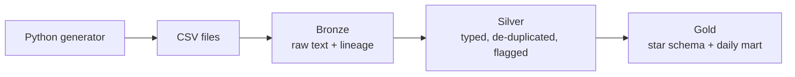

# Banking Data Platform

[](https://github.com/shsbehnam64/banking-data-platform/actions/workflows/ci.yml)

An end-to-end batch pipeline for synthetic bank transaction data, built with dbt and DuckDB using a Bronze / Silver / Gold (medallion) architecture.

> All data is generated by a script. It contains no real customers, accounts or employer data.

## Architecture



| Layer | Models | Purpose |
|---|---|---|
| Bronze | `bronze_*` | Keeps source values as text and records source file and load time |
| Silver | `silver_*` | Casts types, removes duplicate transactions, flags quality issues |
| Gold | `dim_customers`, `dim_accounts`, `dim_date`, `fct_transactions`, `mart_daily_channel_summary` | Reporting-ready tables |

## Data quality

The generator injects problems on purpose:

| Issue | Rows | Handling in Silver |
|---|---|---|
| Duplicate transactions | 250 | One row kept, copy count recorded |
| Late-arriving (more than 24 hours) | 555 | Flagged with `is_late_arriving` |
| Missing channel | 156 | Set to `unknown` and flagged |

`dbt build` runs 13 models and 61 data tests, including:

- Daily row counts and amounts in Silver reconcile to the source control totals
- Duplicate copies are identical, so de-duplication does not hide conflicting data
- Transaction counts and amounts match between Silver and the Gold mart
- Uniqueness, not-null, accepted-value and relationship checks

## Continuous integration

GitHub Actions runs on every push to `main` and on pull requests. It installs the dependencies, generates the data and runs `dbt build` using the profile in `ci/profiles.yml`.

## Design decisions

- **Text in Bronze:** type conversion happens in one place (Silver), and the received values stay available.
- **Decimal for money:** amounts use `decimal(18, 2)` to avoid floating-point rounding errors.
- **Flag rather than drop:** late and incomplete records stay visible to downstream users.
- **Data minimisation:** Gold excludes names, email addresses and full postcodes.

## Run it locally

Requires Python 3.14 and Git. Commands are for Windows PowerShell.

```powershell
git clone https://github.com/shsbehnam64/banking-data-platform.git
cd banking-data-platform
py -3.14 -m venv .venv
.\.venv\Scripts\Activate.ps1
pip install -r requirements.txt
python scripts/generate_data.py
```

Add this profile to `~/.dbt/profiles.yml`:

```yaml
banking_dbt:
  target: dev
  outputs:
    dev:
      type: duckdb
      path: dev.duckdb
```

Then build and test:

```powershell
cd banking_dbt
dbt build
```

## Current limitations

- Every model is fully rebuilt on each run.
- Customer changes are not yet tracked over time.
- Names and email addresses remain in Bronze and Silver; access controls are not yet implemented.
- The pipeline is run manually; there is no scheduler yet.

## Roadmap

- [x] Continuous integration with GitHub Actions
- [ ] Incremental transaction model
- [ ] Customer history (SCD Type 2)
- [ ] Orchestration with Airflow
- [ ] Postgres source, AWS S3 and Snowflake
- [ ] Power BI dashboard
